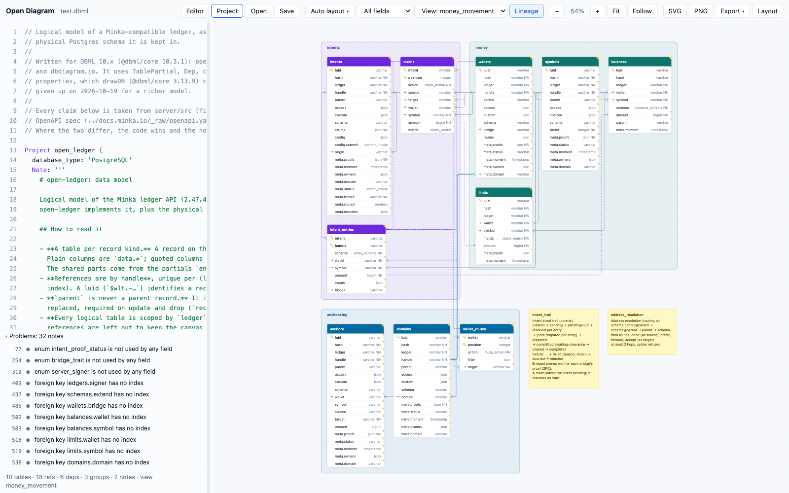

# Open Diagram

Offline DBML diagram renderer in a single `index.html`: no server, no network, no build step to use it.
It reads the same DBML as [dbdiagram.io](https://dbdiagram.io) (parsed by `@dbml/core` 10.x), for
anyone who keeps a database schema as text and wants to see it, lay it out and export it locally.

**[Try it](https://stepanic.github.io/open-diagram/)**, or open `index.html` from a clone.



## Why

dbdiagram.io is proprietary and online only; its open part is the DBML parser. drawDB imports DBML
through `@dbml/core` 3.x, which does not read current DBML (TablePartial, DiagramView, Dep, records).
Open Diagram uses the current parser and draws everything with its own SVG renderer.

## Use

Open `index.html` directly (`file://` works).

- **Open / Save**: load a `.dbml` (or a `.layout.json`), download the DBML. Drag and drop works too.
- **Drag** a table by any part of it; drag a TableGroup by its title to move the whole group.
- **Scroll** pans, **pinch** or **⌘/Ctrl + scroll** zooms, **F** fits, **Esc** clears the selection.
- **Click** a table to highlight its refs, **double-click** to jump to it in the editor.
- **Follow** (or **Z**): the canvas zooms to the element under the editor caret, between 50 % and
  125 %; a field fits its table, a ref both tables. Moving within the same table only pans if the
  row leaves the screen. A manual pan or zoom pauses it until the caret reaches another element.
- **Hover** a field, header, ref or group title for notes, flags, defaults, enum values and refs.
- **Problems** under the editor: checks the parser does not make (no primary key, duplicate index or
  index name, `not null` with `default: null`, refs between different types, `set null` on a
  `not null` column, one-to-one refs on non-unique columns, foreign keys without an index, unused
  enums) and refs that column names suggest (`user_id` → `users.id`). Click one to jump to its line;
  **Add N refs** appends the suggested `Ref:` lines at the end of the source for review (⌘Z undoes).
- **Export ▾**: Mermaid `erDiagram` (`.mmd`, plus a fenced block on the clipboard), Markdown
  documentation (project note, Mermaid diagram, every table with fields, indexes and refs, enums),
  and SQL for PostgreSQL, MySQL, SQL Server or Oracle. Mermaid and Markdown follow the current
  DiagramView; SQL is always the whole model.
- **Detail**: all fields, keys only (PK/FK/referenced), or names only.
- **Auto layout** discards manual positions and offers four algorithms (keys **1–4** while the menu
  is open): **Left-right** (follows foreign keys), **Pipeline** (groups as stages left to right,
  tables stacked), **Snowflake** (most connected in the centre), **Compact** (rectangle packing).
  The last one used is remembered. Positions are remembered per file name in
  localStorage; **Layout** downloads them as JSON so they can travel with the `.dbml`.

## Supported DBML

- `Project` with a Markdown note (**Project** panel, key **P**)
- tables: schemas, aliases, `headercolor`, notes, `check` and `checks { }`, custom properties
  and `Metadata` blocks (in tooltips)
- fields: pk, unique, not null, increment, default, note, inline refs; enum types
- indexes, composite and single-column
- `Ref` with every relation type, composite refs, optional ends (`>?`, drawn 0..1) and inactive
  refs (dashed)
- enums, `TableGroup` (colour, note) and sticky `Note`s
- `TablePartial` (injected fields are marked), `records` (a sample in the table tooltip)
- `DiagramView` (view picker in the toolbar) and data lineage `Dep` (key **L** toggles it)

Not supported: modules (`use` / `reuse` across files) and SQL import (SQL export works).
Details per feature, in Croatian: [docs/2026-10-19-dbml-znacajke.md](docs/2026-10-19-dbml-znacajke.md).

## Customise

All visual decisions are in [`src/theme.js`](src/theme.js): fonts, sizes, colours, ref markers
(`crowsfoot` or `labels`), group styling, ELK layout options. SVG/PNG export embeds the same styles.

| File | Role |
| --- | --- |
| `src/model.js` | DBML → plain model (tables, refs, groups, notes, enums) via `@dbml/core` |
| `src/lint.js` | schema checks and ref suggestions for the Problems panel |
| `src/export.js` | Mermaid `erDiagram` and Markdown documentation |
| `src/geometry.js` | box sizes, ref routing with obstacle avoidance, markers |
| `src/layout.js` | the four auto layouts (ELK layered, stack, spiral, shelf packing), groups first, then the whole diagram |
| `src/render.js` | SVG drawing and export |
| `src/highlight.js` | DBML syntax highlighting for the editor (coloured layer under a transparent textarea) |
| `src/app.js` | editor, pan/zoom/drag, tooltips, persistence, files |

## Develop

```bash
npm install
npm run build:vendor   # rebuild vendor/ from node_modules (only after upgrading a library)
npm test               # headless Chrome smoke test on examples/open-ledger.dbml
npm test -- my.dbml    # same on another file
```

`vendor/` is committed so the app runs without `npm install`. The `@dbml/core` bundle leaves out
its SQL importers (ANTLR, ~34 MB), so it is ~0.6 MB: DBML is parsed, and SQL can be exported
but not imported.

## Licences

Open Diagram: MIT. Bundled in `vendor/`: [`@dbml/core`](https://github.com/holistics/dbml)
(Apache-2.0) and [`elkjs`](https://github.com/kieler/elkjs) (EPL-2.0), with their bundled
dependencies; licence texts in [`vendor/THIRD_PARTY_LICENSES.md`](vendor/THIRD_PARTY_LICENSES.md).
`examples/open-ledger.dbml` is from [pinkainc/open-ledger](https://github.com/pinkainc/open-ledger) (MIT).

## Design notes (in Croatian)

- [docs/2026-10-17-renderer-odluke.md](docs/2026-10-17-renderer-odluke.md): odluke, mjerenja rasporeda, zamke, otvorene stavke
- [docs/2026-10-19-dbml-znacajke.md](docs/2026-10-19-dbml-znacajke.md): sve značajke DBML-a, što Open Diagram od njih prikazuje, što dodati
- [docs/2026-10-19-embed.md](docs/2026-10-19-embed.md): prijedlog read-only ugradnje dijagrama u druge web stranice
